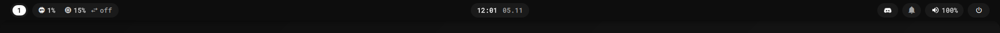
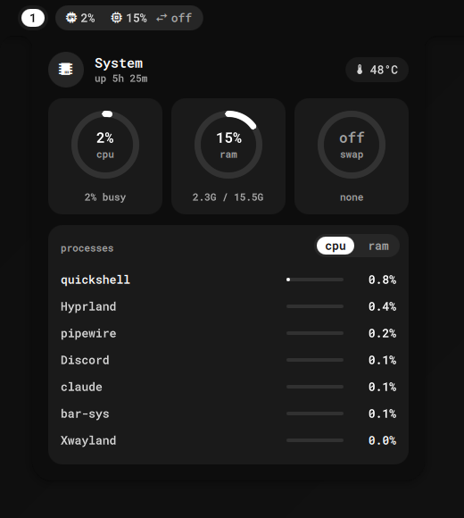
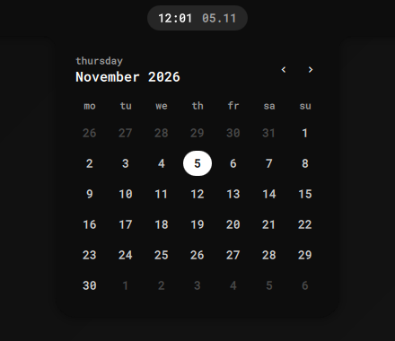
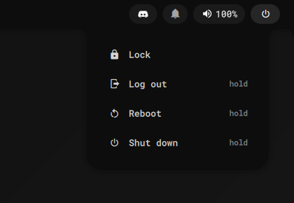
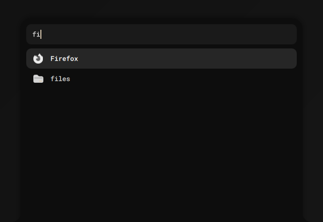

<div align="center">



<br>

[](#requirements)
[](#requirements)
[](https://quickshell.org)
[](#license)

# bar

A quiet, monochrome top bar for Hyprland, with an app launcher, notifications and a lock
screen built in. One command installs it.





</div>

## What's in it

| | |
|---|---|
| **Workspaces** | your workspace numbers on every monitor; click one to go there |
| **System** | CPU, memory, swap; click for temperature and the busiest programs (right-click one to close it) |
| **Network** | scroll the system chip: live upload/download, a graph and which programs use the network |
| **Clock** | click for a calendar; scroll to switch to what's playing (music and video controls) |
| **Tray** | the usual app icons, with their menus |
| **Notifications** | pop-ups, a history and do-not-disturb |
| **Volume** | slider and a list to switch speakers or headphones |
| **Power** | lock, log out, reboot, shut down (hold to confirm, so nothing happens by accident) |
| **Lock screen** | unlock with your normal login password |
| **App launcher** | `SUPER + R`, type a few letters, Enter. It learns what you open most |
| **Look** | flat by default, or "glass" (see-through with blur); your choice is remembered |

<div align="center">

</div>

## Install

```sh
curl -fsSL https://raw.githubusercontent.com/uhm26/bar/main/install.sh | sh
```

That's it. The installer:

- downloads the bar and checks it wasn't damaged or changed on the way (SHA-256),
- puts it in `~/.config/quickshell/bar` and its two small helper programs in `~/.local/bin`
  (no root, nothing system-wide),
- picks your icon theme,
- asks before adding three things to your Hyprland config: start the bar at login, `SUPER + R`
  for the launcher, and blur behind it. It keeps a backup of your config.
- tells you the one `pacman` line to run if something is missing (like the font).

Start it right away with `qs -c bar`. Run the same command again to update.

**Already have a bar or notification program?** Close Waybar, mako, dunst or swaync and
take them out of your autostart: only one program can show notifications and tray icons.

## Requirements

- Arch Linux (or an Arch-based distro), x86_64.
- Hyprland 0.57 or newer (the Lua config, `hyprland.lua`).
- From the Arch repos: `quickshell`, `ttf-roboto-mono-nerd`, `pipewire` + `wireplumber`
  (sound). The installer checks these.

## Use

| Do this | How |
|---|---|
| Open the launcher | `SUPER + R` |
| Open a panel | click its chip in the bar |
| Switch flat / glass | `qs -c bar ipc call bar toggleGlass` |
| Do not disturb | in the notifications panel (the bell), or `qs -c bar ipc call bar toggleDnd` |
| Lock the screen | power menu → Lock, or `qs -c bar ipc call bar lock` |
| Restart the bar | `qs -c bar kill; qs -c bar` |

Bind any of these to keys in your Hyprland config. A lock key, for example:
`hl.bind("SUPER + L", hl.dsp.global("quickshell:lock"))`.

## Extras

Optional additions the default bar leaves out. Install them with `--extra`:

```sh
curl -fsSL https://raw.githubusercontent.com/uhm26/bar/main/install.sh | sh -s -- --extra
```

Updates keep them; `--no-extra` removes them.

| Extra | How |
|---|---|
| AMOLED: every background pure black | `qs -c bar ipc call extra toggleAmoled` (remembered) |

## How heavy is it

Measured on a 6-core desktop with two monitors:

| | |
|---|---|
| CPU while idle | about 0.15 % of one core (it only redraws when something changes) |
| CPU with the system panel open | about 10 % of one core (its live charts move every second) |
| Memory | about 290 MB, most of it Qt and the graphics driver |
| Helpers | `bar-sys` (system stats) and `bar-launcher` (app search): under 1 MB each |

## Uninstall

```sh
curl -fsSL https://raw.githubusercontent.com/uhm26/bar/main/install.sh | sh -s -- --uninstall
```

Removes the bar, its helpers and the one line it added to your Hyprland config.

## Build from source

The bar itself is QML and needs no building. The two helpers are Rust:

```sh
git clone https://github.com/uhm26/bar
cd bar
cargo build --release
cp target/release/bar-sys target/release/bar-launcher ~/.local/bin/
qs -p shell
```

To try the extras on a bar run from the repo: `./extras on` (and `./extras off`). It
restarts the bar.

## About

Built on [Quickshell](https://quickshell.org). I made it for my own Hyprland setup with
Claude: I decide what it does and how it looks, Claude writes most of the code, and I use
it every day.

## License

MIT or Apache-2.0, at your option: [LICENSE-MIT](LICENSE-MIT), [LICENSE-APACHE](LICENSE-APACHE).
